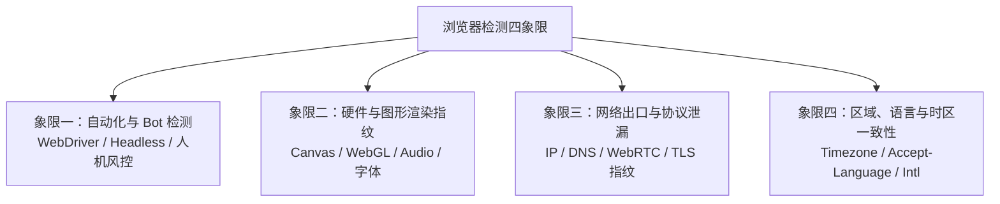

# 常见浏览器检测网站参考

本文档按检测维度划分为四个象限，用于验证多账号指纹隔离、代理出口、协议泄漏以及区域一致性。

## 象限总览



## 1. 自动化与 Bot 检测

重点核验 `navigator.webdriver` 是否隐藏、无头特征是否暴露，以及真实网站的人机风控通过率。

| 网站                                                | 侧重点                                     | 使用建议                             |
| :-------------------------------------------------- | :----------------------------------------- | :----------------------------------- |
| [Sannysoft Bot Test](https://bot.sannysoft.com/)    | `webdriver`、Chrome 运行时属性与自动化特征 | 快速回归，整页绿灯即可               |
| [CreepJS](https://abrahamjuliot.github.io/creepjs/) | 无头特征、Worker 与浏览器异常熵检测        | 查看顶部异常告警与信任评分           |
| [Fingerprint Demo](https://fingerprint.com/demo/)   | 商业指纹 ID 稳定性与 Bot 识别              | 对照不同 `--session` 是否生成独立 ID |
| [NowSecure](https://nowsecure.nl/)                  | Cloudflare 人机挑战实机通关测试            | 建议配合 `--headed` 观察验证页行为   |

## 2. 硬件与图形渲染指纹

重点核验同一持久档案的 `--fingerprint` 种子是否跨重启稳定，以及不同账号之间是否产生差异化噪声。

| 网站                                                   | 侧重点                                        | 使用建议                                        |
| :----------------------------------------------------- | :-------------------------------------------- | :---------------------------------------------- |
| [BrowserLeaks Canvas](https://browserleaks.com/canvas) | Canvas 图像渲染哈希                           | 对比多账号的 Signature 是否不同、同账号是否恒定 |
| [BrowserLeaks WebGL](https://browserleaks.com/webgl)   | WebGL 渲染器、显卡厂商与扩展列表              | 核对 GPU 参数与图形哈希                         |
| [BrowserLeaks](https://browserleaks.com/)              | 字体、AudioContext、Screen 与硬件并发数总入口 | 按需进入各专项子页核查                          |
| [Pixelscan](https://pixelscan.net/)                    | 硬件指纹与操作系统声明一致性体检              | 重点查看系统与硬件参数自洽性                    |

## 3. 网络出口与协议泄漏

重点核验 `--proxy-server` 代理链路、`--disable-non-proxied-udp` WebRTC 防泄漏策略以及请求头形态。

| 网站                                                   | 侧重点                                | 使用建议                                         |
| :----------------------------------------------------- | :------------------------------------ | :----------------------------------------------- |
| [BrowserLeaks WebRTC](https://browserleaks.com/webrtc) | WebRTC 内网 IP 与公网 IP 泄漏检测     | 确认未暴露本机真实出口与局域网地址               |
| [IPLeak](https://ipleak.net/)                          | IP、DNS 与 WebRTC 综合泄漏检测        | 使用代理时重点查看 DNS 请求归属                  |
| [Peet.ws TLS](https://tls.peet.ws/api/all)             | TLS、JA3/JA4、HTTP/2 指纹与原始请求头 | 核对实际发出的 `Accept-Language` 与 `User-Agent` |

## 4. 区域、语言与时区一致性

重点核验代理 IP 归属地与 `timezone`、`lang`、`acceptLang` 是否匹配。

| 网站                                                   | 侧重点                                          | 使用建议                                     |
| :----------------------------------------------------- | :---------------------------------------------- | :------------------------------------------- |
| [Iphey](https://iphey.com/)                            | 出口 IP 地区、时区、语言头与系统特征综合打分    | 查看 Timezone 与 Language 两项是否为一致状态 |
| [BrowserLeaks JS](https://browserleaks.com/javascript) | `navigator.language`、`Intl` 与 `Date` 时区偏移 | 快速核对 JS 运行时接口返回值                 |

> [!NOTE]
> 在 macOS 下，`--lang` 与 `--accept-lang` 会修改 `navigator.language`、`navigator.languages` 与 HTTP `Accept-Language` 请求头，但 Chromium 在 macOS 上会依据系统 `AppleLanguages` / `AppleLocale` 偏好初始化 `Intl.DateTimeFormat().resolvedOptions().locale`。若在 macOS 上测试英文档案时看到该字段仍显示宿主机区域，属于平台机制而非参数未生效。

## 快速打开命令

日常排查建议默认使用无头模式获取结果；需要人工目视页面或过人机校验时再加 `--headed`：

```sh
# 1. 无头模式快速核对 JS 运行时与语言、时区返回值
agent-browser --session global open "https://browserleaks.com/javascript"
agent-browser --session global eval "JSON.stringify({lang:navigator.language,langs:navigator.languages,tz:Intl.DateTimeFormat().resolvedOptions().timeZone})"
agent-browser --session global close

# 2. 有头模式打开多标签集中目视检查
agent-browser --session fp-check --input-mode human --headed open "https://iphey.com/"
agent-browser --session fp-check tab new "https://bot.sannysoft.com/"
agent-browser --session fp-check tab new "https://browserleaks.com/webrtc"
agent-browser --session fp-check tab new "https://abrahamjuliot.github.io/creepjs/"
```
