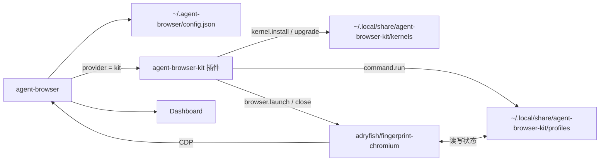
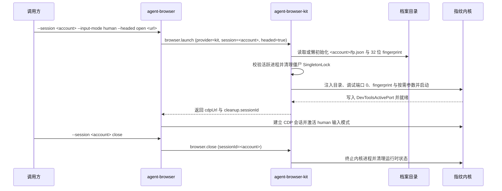

# 基于 fingerprint-chromium 与 agent-browser 的多账号隔离设计

## 1. 目标与边界

- **调用极简**：业务侧通过 `agent-browser --session <account>` 指定账号名，经全局配置自动路由至 `kit` 插件完成环境拉起。
- **隔离与持久化**：每个账号独占 `~/.local/share/agent-browser-kit/profiles/<account>` 目录与一次生成的 32 位随机 `fingerprint`，跨进程重启复用同一身份与认证态。
- **拟人化与接管**：通过 `--input-mode human` 启用人类指针轨迹，并在触发强校验时通过 `Dashboard` 接入人工验证。
- **进程边界**：单账号对应单个浏览器进程；同账号并发任务通过同一进程内多标签页执行。

## 2. 系统架构

### 2.1 组件关系



- **`agent-browser`**：读取全局配置，路由会话生命周期，提供多标签调度、`human` 输入轨迹与 `Dashboard`。
- **`agent-browser-kit`**：托管账号档案与 32 位 `fingerprint`，管理内核下载升级、参数组装、僵尸锁清理及进程回收。
- **`adryfish/fingerprint-chromium`**：执行页面渲染、指纹伪装、状态落盘与 `CDP` 协议服务。

### 2.2 生命周期时序



## 3. 核心设计

### 3.1 全局配置与插件协议

通过 `agent-browser plugin add @taitide/agent-browser-kit --name kit` 安装插件，并在 `~/.agent-browser/config.json` 中设为默认提供方：

```json
{
  "$schema": "https://agent-browser.dev/schema.json",
  "provider": "kit",
  "plugins": [
    {
      "name": "kit",
      "command": "agent-browser-kit",
      "capabilities": ["browser.provider", "command.run"]
    }
  ]
}
```

`agent-browser` 通过标准输入输出以 `agent-browser.plugin.v1` 协议与 `agent-browser-kit` 交互：

1. **`plugin.manifest`**：声明插件名称 `kit` 与能力 `["browser.provider", "command.run"]`。
2. **`browser.launch`**：等待 `<account>/DevToolsActivePort` 就绪后，落盘 `runtime.json`（记录 `pid` 与 `cdpUrl`），并返回 `browser.cdpUrl` 与 `browser.cleanup.sessionId`。
3. **`browser.close`**：按 `sessionId` 读取 `runtime.json` 终止对应内核进程并清理运行时文件。
4. **`command.run` 管理接口**：
   - `kernel.install`：若已安装有效内核则直接跳过；未安装时按平台下载并激活。
   - `kernel.upgrade`：未安装时下载安装；已安装且云端存在更高版本时下载升级并替换激活路径。
   - `kernel.status`：查询当前激活内核版本与路径。
   - `profile.create` / `profile.list` / `profile.delete`：管理账号档案与覆盖配置。

### 3.2 档案存储与指纹生成

- **目录约定**：固定存储在 `~/.local/share/agent-browser-kit/`，不引入环境变量覆盖，遵循单一事实原则。
  - `config.json`：记录当前激活的内核版本与可执行文件路径。
  - `kernels/<version>/`：按版本存放已下载的内核文件。
  - `profiles/<account>/fp.json`：账号指纹与覆盖参数。
- **元数据（`fp.json`）**：
  - `fingerprint`：建档时通过密码学安全随机数生成器（CSPRNG）生成的 32 位无符号整数（`1` 至 `4294967295`），持久化后跨重启复用。
  - 可选覆盖字段：`proxy`、`timezone`、`lang`、`acceptLang`、`platform`、`windowSize`。

### 3.3 内核拉起与参数组装

- **内核来源**：从 `adryfish/fingerprint-chromium` GitHub Release 按当前系统平台下载（仓库定时动作自动同步新版本清单）。
- **基线启动参数**：

```bash
chrome \
  --user-data-dir=~/.local/share/agent-browser-kit/profiles/<account> \
  --remote-debugging-port=0 \
  --fingerprint=<32位随机整数> \
  --fingerprint-brand=Chrome \
  --no-first-run \
  --no-default-browser-check
```

- 未传入 `headed: true` 时附加 `--headless=new`。
- 当元数据存在对应覆盖字段时按需追加：`--proxy-server`、`--timezone`、`--lang`、`--accept-lang`、`--fingerprint-platform`、`--window-size`。

### 3.4 进程防重入与锁恢复

- **活跃复用**：若目标账号 `runtime.json` 记录的进程仍在运行且 `cdpUrl` 端口可达，`browser.launch` 直接返回当前活跃连接。
- **僵尸锁清理**：拉起内核前检查 `SingletonLock` 与 `runtime.json`；若记录的进程已退出，清理僵尸锁后再启动内核。
